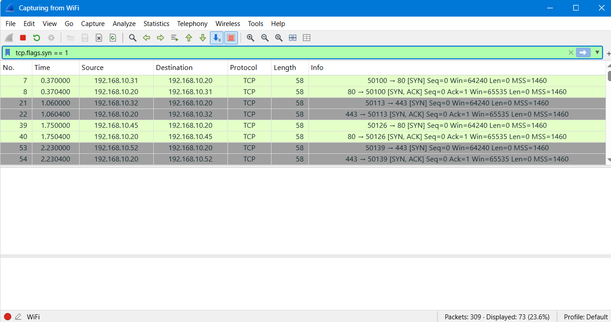
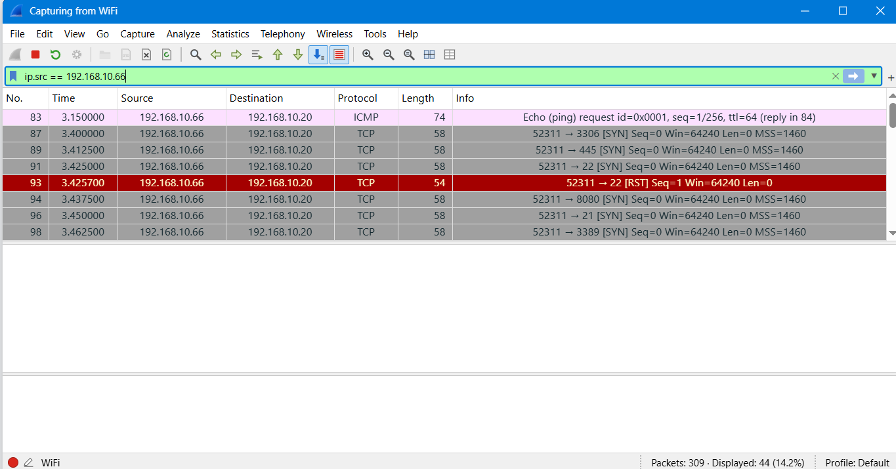
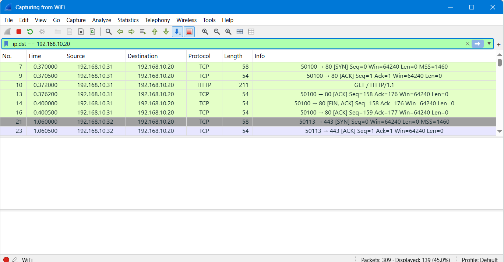
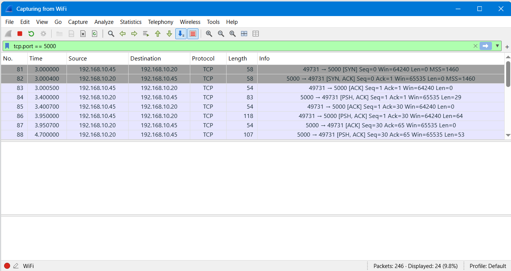
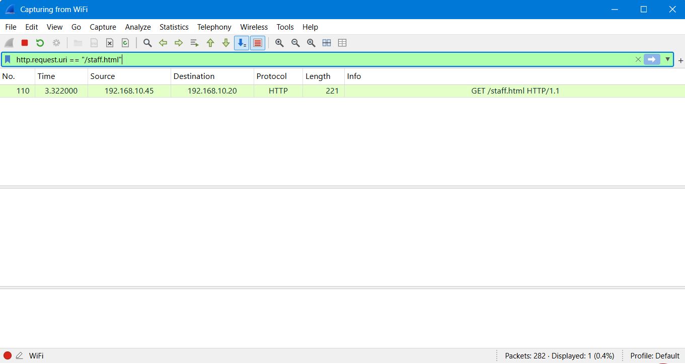
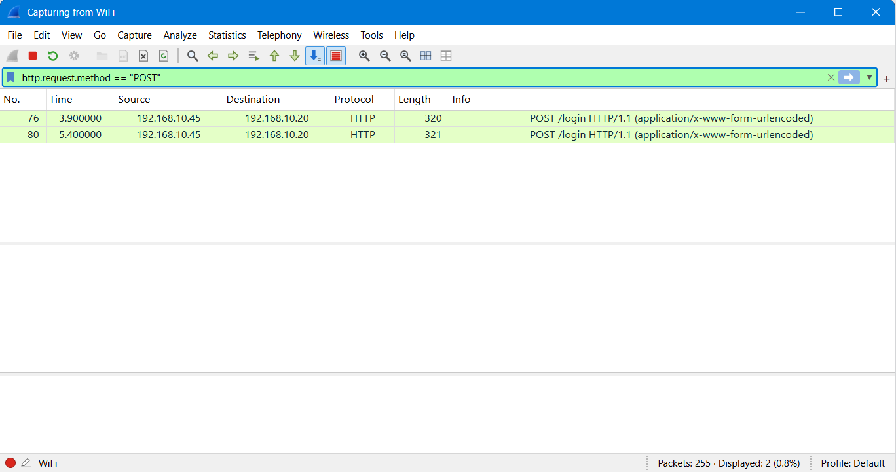
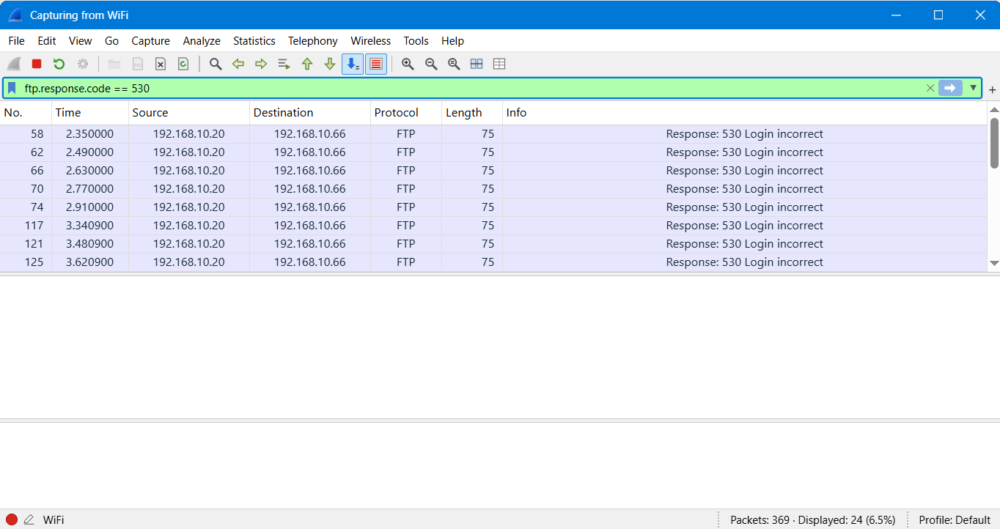
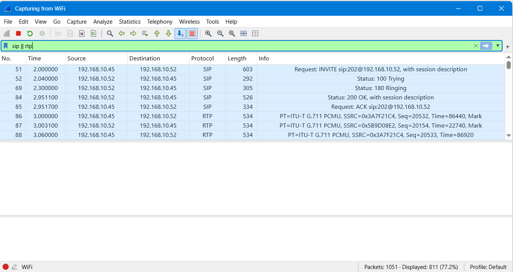

<h1 align="center">🛡️ NetworkWalks B084 | Week 1 – Wireshark SOC Labs</h1>

<p align="center">
  
  
  
  
</p>

<p align="center">
  <strong>🔍 NETWORK TRAFFIC ANALYSIS | THREAT DETECTION | SECURITY INVESTIGATION</strong>
</p>

---

## 📌 About the Project

Welcome to my **Week 1 Wireshark SOC Labs** project, completed as part of the **NetworkWalks Cybersecurity Internship**.

This repository documents my practical work across six SOC labs (Lab 3–Lab 8). I used Wireshark to analyze network traffic, investigate suspicious activities, and understand common cybersecurity threats.

The project focuses on hands-on learning through packet analysis, protocol investigation, and Wireshark display filters.

## ⚙️ Tools & Technologies

| Tool | Purpose |
|:---|:---|
| 🦈 Wireshark | Network traffic analysis |
| 🌐 TCP/IP | Network communication analysis |
| 🔎 Display Filters | Packet filtering and investigation |
| 📡 HTTP / FTP | Web and file transfer analysis |
| ☎️ SIP / RTP | VoIP traffic analysis |

---

# 🧪 Practical SOC Labs

## 🔹 Lab 3 – Identify the Attacker's IP

**🎯 Objective:** Identify the attacker, target IP, and port-scanning activity.

**🔎 Wireshark Filters:**

```wireshark
tcp.flags.syn == 1
ip.src == 192.168.10.66
ip.dst == 192.168.10.20
```

**📊 Key Findings:**
- Identified attacker IP: `192.168.10.66`.
- Identified target IP: `192.168.10.20`.
- Analyzed SYN packets.
- Investigated port-scanning activity.
- Identified open and closed port responses.

**📸 Lab Screenshots**







---

## 🔹 Lab 4 – Follow TCP Stream 1

**🎯 Objective:** Reconstruct a TCP chat conversation using Wireshark.

**🔎 Wireshark Filter:**

```wireshark
tcp.port == 5000
```

**📊 Key Findings:**
- Identified chat traffic.
- Used Follow TCP Stream to reconstruct communication.
- Learned how unencrypted communication can expose sensitive information.

**📸 Lab Screenshot**



---

## 🔹 Lab 5 – Follow TCP Stream, Part 2

**🎯 Objective:** Investigate a hidden note in an intranet web page.

**🔎 Wireshark Filter:**

```wireshark
http.request.uri == "/staff.html"
```

**📊 Key Findings:**
- Identified the requested web page.
- Investigated HTTP traffic.
- Learned how hidden HTML comments can expose internal information.

**📸 Lab Screenshot**



---

## 🔹 Lab 6 – HTTP Plain Text Credentials

**🎯 Objective:** Investigate HTTP login requests and understand credential exposure.

**🔎 Wireshark Filter:**

```wireshark
http.request.method == "POST"
```

**📊 Key Findings:**
- Identified HTTP POST login requests.
- Investigated login traffic.
- Learned why HTTPS is important for protecting credentials.

**📸 Lab Screenshot**



---

## 🔹 Lab 7 – Catch the Brute Force Attacker

**🎯 Objective:** Identify repeated failed FTP login attempts.

**🔎 Wireshark Filter:**

```wireshark
ftp.response.code == 530
```

**📊 Key Findings:**
- Identified repeated failed login attempts.
- Investigated FTP response codes.
- Learned how to recognize brute-force activity.

**📸 Lab Screenshot**



---

## 🔹 Lab 8 – VoIP Call Replay

**🎯 Objective:** Analyze VoIP communication using SIP and RTP traffic.

**🔎 Wireshark Filter:**

```wireshark
sip || rtp
```

**📊 Key Findings:**
- Identified SIP call signaling.
- Investigated RTP voice traffic.
- Learned about the importance of securing VoIP communication.

**📸 Lab Screenshot**



---

## 🧠 Skills & Learning Outcomes

- 🔍 Network Traffic Analysis
- 🦈 Wireshark Display Filters
- 🌐 TCP/IP Investigation
- 📡 Network Protocol Analysis
- 🎯 IP Address Identification
- 🔗 TCP Stream Analysis
- 🔐 HTTP and FTP Security Analysis
- 🚨 Port Scanning Detection
- ⚠️ Brute Force Detection
- ☎️ SIP and RTP Traffic Analysis

---

## 🙏 Acknowledgements

Special thanks to **Waqas Karim (CCIE)** and **NetworkWalks** for providing this cybersecurity learning opportunity and practical SOC lab exercises.

---

## 🎓 Internship Information

| **Detail** | **Information** |
|:---|:---|
| Organization | NetworkWalks |
| Program | Cybersecurity Internship |
| Module | Week 1 |
| Project | Wireshark SOC Labs |
| Labs | Lab 3 – Lab 8 |

---

## 👨‍💻 About Me

### Musadiq Qureshi

🎓 BSCS Graduate | Cybersecurity Learner

[](https://github.com/musadiq-qureshi)

[](https://www.linkedin.com/in/musadiq-qureshi-32271936a/)

---

**🚀 LEARNING • PRACTICING • GROWING IN CYBERSECURITY**

*Hands-on learning through practical cybersecurity labs.*

⭐ If you find this project useful, consider giving it a star!
